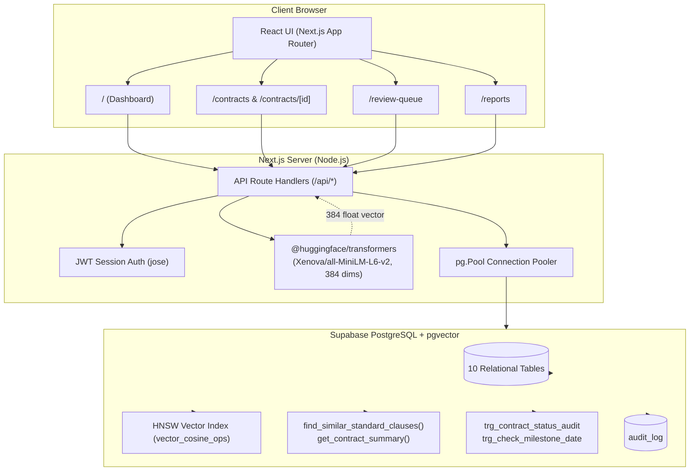
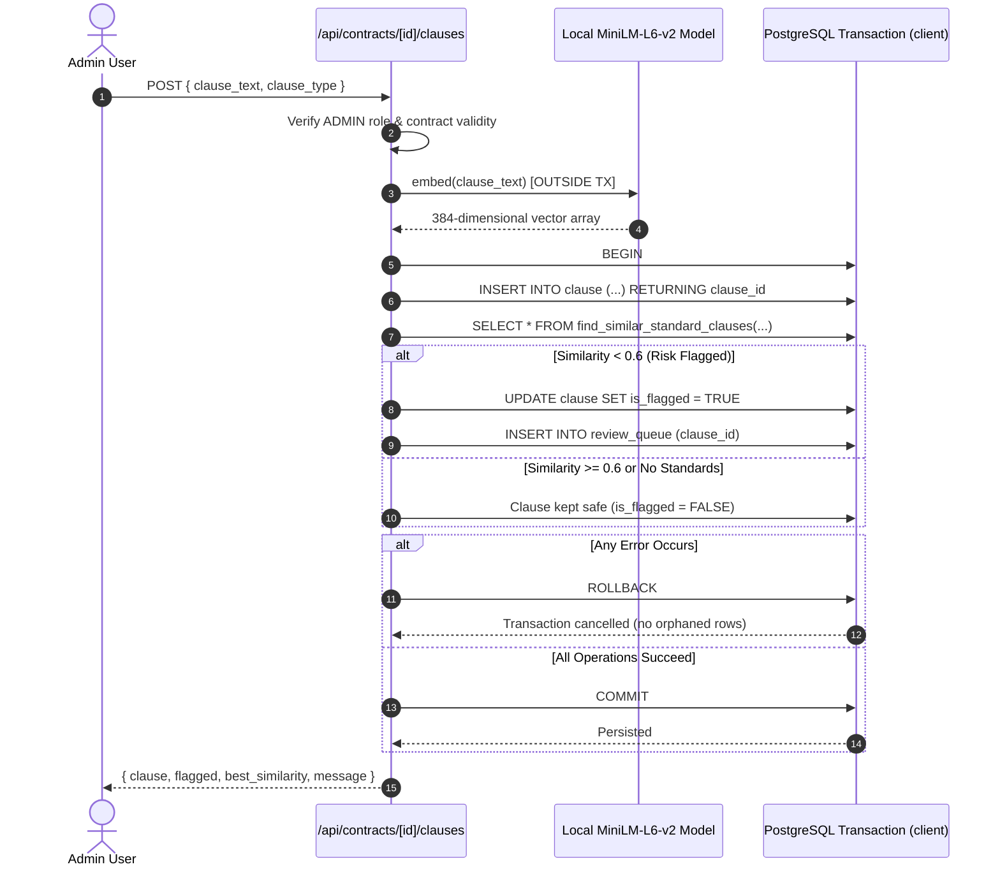
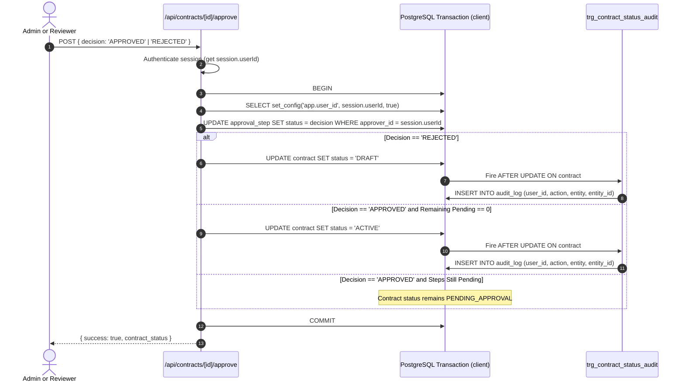

# LexiContract System Architecture & Transaction Flows

This document details the architectural layout, technology stack, and atomic transaction workflows of LexiContract.

---

## 1. High-Level System Architecture

---

## 2. Component Breakdown

1. **Client Tier**: Next.js App Router with React Client Components (`"use client"`), Tailwind CSS styling, responsive tables, forms, and role-conditioned UI controls.
2. **Application Tier**:
   - Next.js Server API Routes running on Node.js.
   - Session authentication managed via HMAC-SHA256 signed JWT cookies (`jose` library).
   - Local Embedding Engine: `@huggingface/transformers` running the `Xenova/all-MiniLM-L6-v2` ONNX pipeline locally. Embeddings are generated in-process before database transactions begin, keeping transactions fast and avoiding external API latencies.
3. **Database Tier**: Supabase PostgreSQL 15+ with the `pgvector` extension.
   - HNSW index on `vector(384)` with `vector_cosine_ops` for fast similarity lookup.
   - Stored SQL procedures for analytics and vector cosine calculations.
   - Event triggers enforcing date integrity and auditing contract state transitions.

---

## 3. Transaction Flow 1: Clause Insertion & Risk Audit

Guarantees atomicity: a clause is either fully created (and queued for review if risky) or completely rolled back if any error occurs.

---

## 4. Transaction Flow 2: Multi-Party Approval & Audit Trigger

Guarantees atomic sign-off and feeds the PostgreSQL status audit trigger with the acting user ID.

